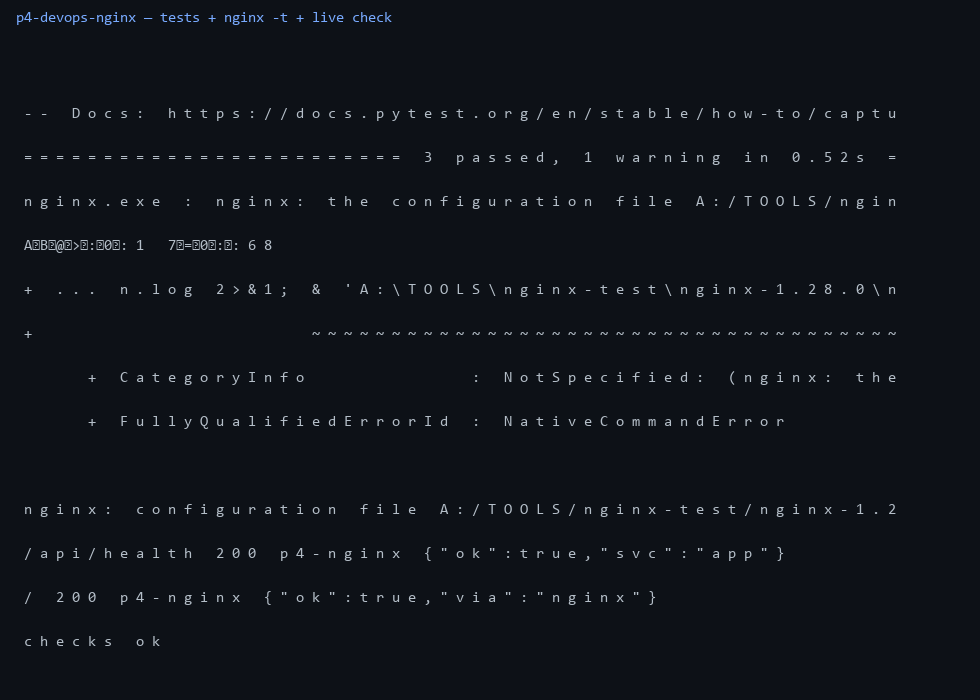

# p4-devops-nginx — прокси, компоуз, CI

Проект под вакансию с Хабр Карьеры: **Системный администратор с DevOps**.
Закрывает: Linux, CI/CD, Nginx.

## что внутри

- `app/` — демо API (FastAPI) + Dockerfile
- `nginx/nginx.conf` — реверс-прокси: `/api/` в app, gzip, заголовок `X-Served-By`
- апстрим через переменную + `resolver 127.0.0.11` — nginx стартует даже если app еще не поднялся
- `docker-compose.yml` — связка app + nginx, сайт на `:8080`
- `.github/workflows/ci.yml` — линт, pytest, сборка образа
- `scripts/check.py` — живой чек через прокси (stdlib, мимо проксей)
- `scripts/backup.sh` — пак бэкап томов

## запуск (compose)

```bash
docker compose up --build
python scripts/check.py  # BASE=http://localhost:8080
```

## проверки локально (без докера)

```bash
python -m pytest tests -q
nginx -t -c nginx/nginx.conf          # syntax ok
python scripts/check.py               # связка nginx -> app, обе 200
```

## прогон



`3 passed`, `syntax ok`, обе ручки `200` с заголовком `p4-nginx`.
